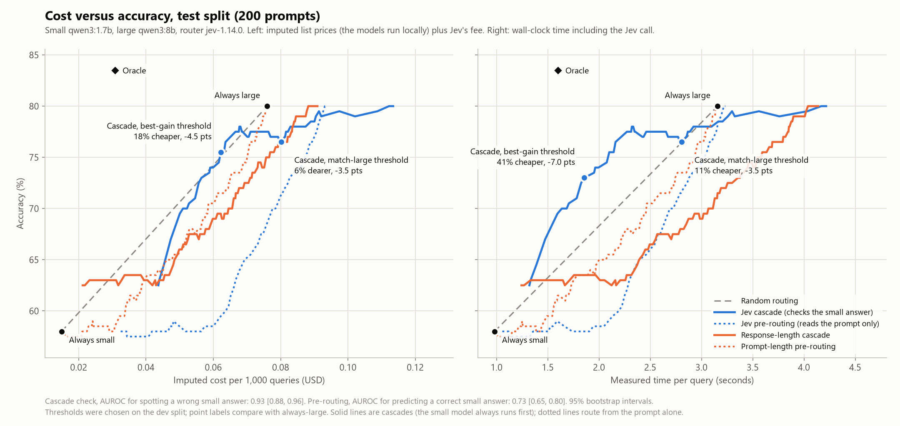

# Jev LLM cost router

A router that uses [Jev](https://docs.typesafe.ai) (TypeSafe AI's decision model) to decide when a cheap small
LLM is good enough and when a prompt needs an expensive large one, plus an evaluation of whether that beats
simple baselines on a cost versus accuracy curve.

The evaluation is the point. Two ways of using Jev were measured:

- **Pre-routing.** Jev reads the prompt and answers one yes/no question: will a small model get this right?
  The prompt then goes to one model.
- **Cascade.** The small model answers first. Jev reads the prompt and the answer and returns the probability
  that the answer is wrong. The large model is called only when that probability reaches a threshold.

## Findings

On 200 held-out benchmark prompts with two local models (`qwen3:1.7b` as small, `qwen3:8b` as large):

1. **Pre-routing did not help.** Jev predicts whether the small model will be right (AUROC 0.725), but routing
   on that was worse than sending prompts to the large model at random, because the prompts Jev rates hardest
   are ones the large model also gets wrong.
2. **Jev is a reliable checker of the small model's answers.** It separates wrong answers from right ones with
   an AUROC of 0.927, and at a threshold of 0.2 it catches 63 of the 72 wrong answers it sees.
3. **The cascade saves compute time, at some cost in accuracy.** At its speed-oriented threshold it takes 41%
   less time than always using the large model and scores 73.0% against 80.0%, which is 6.2 points better
   than random routing at the same time budget.
4. **It does not save money at these prices,** and it never matches the large model's accuracy cheaply. One
   Jev check costs about 31% of a call to this large model, and the small model is right only 58% of the time.
5. The cascade pattern needs a large model that costs many times more than the small one, and a small model
   that is right most of the time. This pair has neither, so treat the saving here as a lower bound on the
   pattern, not as its typical result.



Left panel: cost in dollars at imputed list prices, including Jev's fee. Right panel: measured wall-clock time
per query, including the Jev call. Solid lines are cascades, dotted lines are pre-routing. The dashed grey
line is random routing, the baseline every policy has to beat.

## Numbers

Test split, 200 prompts. Brackets are 95% bootstrap intervals from 1,000 resamples. Every threshold was
chosen on the 200-prompt dev split. All figures come from [`results/metrics.json`](results/metrics.json).

### Policies

| Policy | Accuracy | Seconds per query | USD per 1,000 queries | Sent to large |
|---|---|---|---|---|
| Always small | 58.0% [51.5, 65.0] | 0.98 [0.85, 1.12] | 0.0149 | 0% |
| Always large | 80.0% [74.0, 85.0] | 3.16 [2.79, 3.59] | 0.0760 | 100% |
| Prompt-length pre-routing | 80.0% [74.0, 85.0] | 3.14 [2.76, 3.56] | 0.0755 | 99% |
| Jev pre-routing | 78.5% [73.0, 84.0] | 3.17 [2.78, 3.61] | 0.0914 | 92% |
| Jev cascade, accuracy-oriented (threshold 0.28) | 76.5% [70.0, 82.5] | 2.81 [2.34, 3.39] | 0.0802 | 43% |
| Jev cascade, speed-oriented (threshold 0.86) | 73.0% [67.0, 79.0] | 1.86 [1.49, 2.31] | not tuned for this view | 20% |
| Oracle (large only when it fixes a small-model error) | 83.5% [78.0, 89.0] | 1.60 [1.33, 1.90] | 0.0308 | 26% |

The pre-routing rows and the accuracy-oriented cascade use the cheapest dev threshold that stayed within one
accuracy point of always-large on dev. For both pre-routing policies that threshold sends nearly everything
to the large model. The speed-oriented cascade uses the dev threshold furthest above the random-routing line
in time; the dollar view picks a different threshold (0.78) for that rule, which is in `metrics.json`.

### Against always-large

| Jev policy | Accuracy change | Time saved | Dollars saved |
|---|---|---|---|
| Pre-routing | -1.5 points [-3.5, 0.0] | -0.2% [-1.2, 0.9] | -20.3% [-22.5, -18.2] |
| Cascade, accuracy-oriented | -3.5 points [-7.0, -0.5] | 11.2% [2.3, 19.6] | -5.5% [-12.6, 1.3] |
| Cascade, speed-oriented | -7.0 points [-12.0, -2.0] | 41.2% [32.0, 50.3] | see note above |

A negative saving means the policy costs more than always-large.

### Against random routing

Average accuracy advantage over random routing across every budget between always-small and always-large.
No threshold is involved. Positive means better than random.

| Policy | In measured time | In imputed dollars |
|---|---|---|
| Jev cascade | +2.7 points [+0.2, +5.1] | -3.0 points [-5.5, -0.5] |
| Prompt-length pre-routing | -2.9 points [-4.9, -0.8] | -3.5 points [-5.5, -1.5] |
| Response-length cascade | -4.8 points [-7.3, -1.9] | -3.4 points [-5.6, -0.8] |
| Jev pre-routing | -5.8 points [-7.8, -3.8] | -9.5 points [-12.0, -6.9] |

### How good is Jev's signal

| Signal | AUROC |
|---|---|
| Cascade check: is the small model's answer wrong? | 0.927 [0.878, 0.964] |
| Baseline for the same task: response length | 0.713 [0.631, 0.786] |
| Pre-routing: will the small model be right? | 0.725 [0.655, 0.798] |
| Baseline for the same task: prompt length | 0.589 [0.507, 0.674] |
| Pre-routing: is the large model needed (small wrong, large right)? | 0.495 [0.404, 0.585] |

The cascade check at different thresholds, over the 188 test answers Jev was asked about (72 wrong, 116 right):

| Threshold | Wrong answers caught | Right answers flagged anyway | Accuracy of answers that pass |
|---|---|---|---|
| 0.20 | 63 of 72 | 18 of 116 | 91.6% |
| 0.28 | 60 of 72 | 14 of 116 | 89.5% |
| 0.50 | 56 of 72 | 8 of 116 | 87.1% |
| 0.86 | 28 of 72 | 0 of 116 | 72.5% |

The other 12 test responses had no `ANSWER:` line. The cascade sends those to the large model without
calling Jev.

### Calibration of the pre-routing question

Five equal-count bins of Jev's probability that the small model is enough, against what happened.

| Jev probability | Prompts | Small accuracy | Large accuracy | Large cost per 1,000 (USD) |
|---|---|---|---|---|
| 0.18 to 0.55 | 40 | 32.5% | 32.5% | 0.149 |
| 0.56 to 0.70 | 40 | 35.0% | 75.0% | 0.095 |
| 0.70 to 0.79 | 40 | 67.5% | 95.0% | 0.056 |
| 0.79 to 0.85 | 40 | 77.5% | 97.5% | 0.043 |
| 0.85 to 0.95 | 40 | 77.5% | 100.0% | 0.038 |

Jev's probability tracks the small model's accuracy, which is what it was asked. The table also shows why
that is the wrong question for routing: in the lowest bin the large model does no better than the small one
and costs the most, and the large model's advantage is spread across every other bin.

### By source

| Source | Prompts | Small accuracy | Large accuracy |
|---|---|---|---|
| ARC-Challenge | 50 | 74% | 96% |
| GSM8K | 50 | 66% | 96% |
| MMLU | 50 | 58% | 84% |
| MMLU-Pro | 50 | 34% | 44% |

### Jev latency

Jev is added to every request, so its latency matters. Routing question, 400 calls: p50 71 ms, p95 119 ms.
Cascade check, 377 calls: p50 73 ms, p95 116 ms.

## Setup

- **Data.** 400 prompts with exact-match answers, 100 each from `cais/mmlu`, `allenai/ai2_arc` (ARC-Challenge),
  `openai/gsm8k` and `TIGER-Lab/MMLU-Pro`, sampled with a fixed seed and split 50/50 into dev and test,
  stratified by source. Every prompt ends with the same instruction to finish with `ANSWER: <letter or number>`.
- **Grading.** Letter match for multiple choice, normalized numeric match for GSM8K. Only the last `ANSWER:`
  line counts. A response without one, including one cut off at the 600-token cap, is graded wrong.
- **Models.** `qwen3:1.7b` and `qwen3:8b` on a local Ollama server, temperature 0, thinking off.
  Router: `jev-1.14.0`.
- **Costs.** The models run locally, so the dollar figures are imputed: `qwen3:8b` at OpenRouter's list price
  ($0.117 input, $0.455 output per million tokens) and `qwen3:1.7b` scaled down by parameter count
  ($0.025, $0.097). Jev's fee is real ($0.042 per million input tokens). The time figures are measured.
- **Tuning.** Three phrasings of the pre-routing question and three candidate cascade checks were compared on
  dev only. The exact wording is in [`router/jev.py`](router/jev.py).

The total real spend for everything in this repo was about three cents, all on Jev.

## How to run it

Requirements: Python 3.11 or newer, [Ollama](https://ollama.com) with the two models pulled, and a TypeSafe
API key.

```bash
python -m venv .venv
.venv/Scripts/python -m pip install -e ".[dev]"     # on macOS or Linux: .venv/bin/python
ollama pull qwen3:1.7b
ollama pull qwen3:8b
cp .env.example .env                                # then put your key in TYPESAFE_API_KEY
```

| Command | What it does | Calls real APIs |
|---|---|---|
| `make test` | Offline tests with fake Jev and LLM clients | no |
| `make results` | Rebuilds `results/metrics.json` and the chart from the committed caches | no |
| `make smoke ARGS=--yes` | 10 prompts end to end, hard cap $0.50 | yes |
| `make data` | Rebuilds `data/prompts.jsonl` from Hugging Face | no (downloads datasets) |
| `make phrasings ARGS=--yes` | Compares the pre-routing phrasings on dev | yes |
| `make checks ARGS=--yes` | Compares the cascade checks on dev | yes |
| `make eval ARGS=--yes` | Full run: both models, Jev routing question, Jev cascade check, then results | yes |

Every script that calls a real API prints a cost estimate first and stops unless `--yes` is given. Runs are
resume-safe: calls already in `cache/` are skipped, and `max_usd` in `config.yaml` aborts a run that
overspends.

To reproduce the reported numbers without spending anything:

```bash
python eval/simulate.py && python eval/plot.py
```

### Live router

```bash
python -m router "your prompt"              # pre-routing: Jev picks a model, that model answers
python -m router --cascade "your prompt"    # cascade: small answers, Jev checks, large only if needed
```

Both print which model answered, why, the answer, and its cost. If Jev errors or takes longer than 2 seconds,
the request goes to the large model and the fallback is logged. Thresholds are in `config.yaml`.

## Layout

| Path | Contents |
|---|---|
| `router/` | The live router: config, Jev and LLM clients, pre-routing and cascade logic, CLI |
| `evalkit/` | Evaluation library: dataset builder, graders, cached runs, policy simulation |
| `eval/` | Scripts that run each evaluation step |
| `tests/` | Offline tests |
| `data/prompts.jsonl` | The 400 prompts with gold answers and their split |
| `cache/` | Every model and Jev response the results are built from |
| `results/` | `metrics.json` and `cost_quality.png` |
| `NOTES.md` | Running log: differences between Jev's docs and the original spec, decisions, and what went wrong |

To use hosted models, set `provider: openrouter` with a model ID and prices in `config.yaml` and put
`OPENROUTER_API_KEY` in `.env`. That path is covered by a mocked test only and has not been run for real.

## Limitations

- **Benchmark prompts are not real traffic.** These are multiple-choice and arithmetic questions with one
  right answer. Checking an open-ended answer is a harder job for Jev than checking a letter or a number.
- **One model pair, and an unfavourable one for routing.** The large model is about 3 times slower and 5 times
  dearer than the small one, and the small one is right 58% of the time. TypeSafe's own cascade example uses
  a 12 times price gap and a cheap model that is right 93% of the time.
- **Dollar costs are imputed.** Nothing was paid for the LLM calls. The small model's price is an assumption.
- **Time is one laptop, one run.** It includes network time for Jev and whatever else the machine was doing.
- **The cascade analysis was not planned in advance.** The cascade, the time view and the comparisons with
  random routing were added after the pre-routing result on the test split was known. Thresholds and the
  choice of check were still made on dev only, but the positive result needs confirming on a fresh sample of
  prompts before the exact figures are relied on.
- **Single run at temperature 0.** Local runs were not perfectly repeatable: one prompt got a different answer
  from the same model on a second run. The caches are the record of what was measured.
- **One pinned Jev version** (`jev-1.14.0`), one phrasing per question, 200 test prompts. The intervals are wide.
- **Strict grading favours the large model slightly.** About 4% of the small model's responses gave the right
  answer without the required `ANSWER:` line and were marked wrong.
